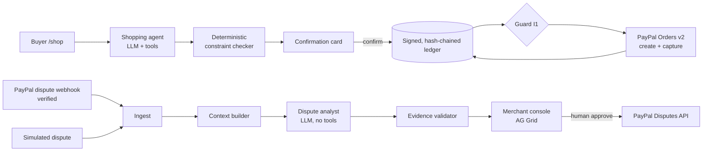

# IntentReceipt

**Receipts for what the AI was asked to do.**

When an AI agent buys something for you, IntentReceipt records exactly what you asked, what the agent understood and what you confirmed, links it to the PayPal order, and uses AI to resolve disputes with verified evidence, fairly for both buyer and seller.

[](LICENSE)  

- **Live demo:** [add Render URL] → click **Run guided demo** (no account needed)
- **Video (2:40):** [add YouTube link]
- **Judges' 5-minute path:** [docs/JUDGES.md](docs/JUDGES.md)

> Built for the PayPal AI Hackathon, "Build What's Next with PayPal and AI". PayPal sandbox only: no real money moves.

## The problem

AI agents are starting to shop for people. When an agent-made purchase goes wrong, nobody can prove what the person actually asked for, what the agent understood, or what the person confirmed. Liability is unclear (agent mistake, buyer's remorse, merchant error or fraud), merchants over-block agent traffic, buyers hesitate to delegate, and dispute teams get no structured evidence about intent.

## What IntentReceipt does

1. **Intent Receipt.** Before payment, the shopping agent's request, extracted constraints, selection and rationale, a **deterministic constraint check** and the buyer's confirmation (including a SHA-256 of the exact card text they saw) are **signed with Ed25519 and hash-chained**, then linked to the PayPal order and capture. Anyone can verify it in the browser.
2. **AI Dispute Analyst.** When a PayPal dispute arrives, an LLM reads the receipt, order, shipping events and messages, classifies the dispute and recommends what the seller should do. **Every citation is a JSON Pointer that code checks against the source data**; unverified citations are dropped and counted. It is deliberately balanced: it recommends a refund when the agent was at fault.
3. **Merchant Console.** An AG Grid queue and a detail view with verified evidence, buyer and seller views side by side, editable drafts and the exact PayPal API request. **A human approves every action.**

## How PayPal is used

| PayPal API / tool | Where | What for |
|---|---|---|
| OAuth2 client credentials | `src/lib/paypal/client.ts` | Sandbox access tokens, cached |
| **Orders v2** create + capture | `src/lib/paypal/orders.ts` | Order created only after a signed confirmation, for exactly the confirmed amount and item (invariant I1). `custom_id = <intent_id>:<hash16>`. Idempotent via `PayPal-Request-Id`. |
| **PayPal JS SDK buttons** (`@paypal/react-paypal-js`) | `src/components/ShopClient.tsx` | Buyer approval in the sandbox popup |
| **Webhooks** + `verify-webhook-signature` | `src/app/api/webhooks/paypal/route.ts`, `src/lib/paypal/webhooks.ts` | Dispute events, signature verified, deduped by event id |
| **Disputes v1** | `src/lib/disputes/actions.ts` | `accept-claim`, `make-offer`, `send-message`, `provide-evidence` after human approval |
| **PayPal Agent Toolkit** (`@paypal/agent-toolkit`) | `src/lib/paypal/toolkit.ts`, `src/lib/ai/agent.ts`, `src/lib/disputes/ingest.ts` | `get_order` as a shopping-agent tool; `get_dispute` to fetch full disputes on real webhooks |

## How AI is used (the product's runtime AI)

- **Shopping agent:** an LLM with tool calling (`search_catalog`, `get_product`, `propose_selection`, `check_order_status`). Default model: **`openai/gpt-oss-120b` (open-weight, Apache 2.0) on Groq's free tier**, through the Vercel AI SDK. Swap providers with env vars only (`AI_PROVIDER=google` for Gemini, `anthropic`).
- **Dispute analyst:** the same layer with structured JSON output, no tools, buyer messages treated as untrusted data.
- **Evidence validator (code, not AI):** checks every citation against the source.
- Claude Code was used as the development tool; it is not part of the running product.

## Honest scope: real vs simulated vs cached

| | Status |
|---|---|
| Checkout (create, approve, capture) | **Real PayPal sandbox** when credentials are configured. Without credentials (e.g. a fresh clone) the same code path creates a `SIM-` order, labelled **SIMULATED**. |
| Seeded order history (S1–S4) | **SIMULATED** orders, but their ledger entries are produced and signed by the real ledger code, so Verify passes. |
| Disputes | Real webhooks are verified and ingested (REAL SANDBOX badge). PayPal has **no API to create disputes**, so the demo disputes are PayPal-shaped payloads sent through the **same ingest function**, labelled **SIMULATED**; actions on them are recorded with the exact request but **not sent**. |
| Analyses | Live model output when a key is configured. Otherwise the seeded scenarios fall back to stored analyses labelled **CACHED** with their origin. [Currently the stored fallbacks are hand-authored and say so; `npm run gen-fixtures` replaces them with real model output.] |

**Limitations.** Sandbox only; no production credentials; no real AP2 cryptographic mandates (the design is *inspired by* PayPal's AP2 mandate-linked receipts, not an implementation of AP2); the ledger is **tamper-evident** (hash chain + signature), not tamper-proof and not a blockchain; no user accounts (demo personas); single currency (USD); no email; the analyst recommends but does not adjudicate liability. Agent replies are not streamed token-by-token.

## Architecture



Invariants (each tested): **I1** no order without a signed confirmation and matching amount/items · **I2** append-only ledger, verified on read · **I3** analyst has no tools, messages are untrusted data · **I4** nothing sent to PayPal without a human click, request stored first · **I5** every AI output stores model, prompt version and input hash · **I6** secrets only from env. Purchases are also bound to the buyer's browser session (httpOnly cookie), so nobody else can confirm, order or capture them. Details: [docs/ARCHITECTURE.md](docs/ARCHITECTURE.md).

## Quick start (under 10 minutes)

Prerequisites: Node 20+ (22 recommended), npm, git.

```bash
git clone <this repo> intentreceipt
```

```bash
cd intentreceipt && npm ci
```

```bash
cp .env.example .env
```

```bash
npm run doctor
```

```bash
npm run dev
```

Open http://localhost:3000 and click **Run guided demo**. With no keys at all, everything works in labelled simulated/cached mode.

To enable the real integrations, fill `.env`:

| Variable | Where to get it |
|---|---|
| `PAYPAL_CLIENT_ID`, `PAYPAL_CLIENT_SECRET`, `NEXT_PUBLIC_PAYPAL_CLIENT_ID` | developer.paypal.com → Apps & Credentials → **Sandbox** → Create App |
| `PAYPAL_WEBHOOK_ID` | In that app: add webhook `https://<your-url>/api/webhooks/paypal` with `CUSTOMER.DISPUTE.CREATED`, `CUSTOMER.DISPUTE.UPDATED`, `CUSTOMER.DISPUTE.RESOLVED`, `PAYMENT.CAPTURE.COMPLETED`. For local dev use a tunnel (`cloudflared tunnel --url http://localhost:3000`) and a second webhook. |
| `GROQ_API_KEY` | https://console.groq.com/keys (free tier, no card). Alternative: `AI_PROVIDER=google` + `GOOGLE_GENERATIVE_AI_API_KEY` from https://aistudio.google.com/apikey |
| `INTENT_SIGNING_KEY` | `npm run gen-keys` (optional in development: a dev key is generated in `data/`) |

Sandbox buyer for the PayPal checkout popup (PayPal **sandbox** test account, no real money): email `sb-wfdf953771758@personal.example.com`, password `n^6CD;M5`.

Other commands: `npm run check` (typecheck + lint + tests) · `npm test` · `npm run e2e` (Playwright smoke + axe accessibility checks; first run `npx playwright install chromium`) · `npm run seed` (reset demo state; `-- --all` wipes everything) · `npm run smoke` (live sandbox checks) · `npm run ai-eval` (S1–S4 × 5 against the live model) · `npm run gen-fixtures`.

## Project structure

```
src/app/            pages (/, /shop, /orders, /receipt/[id], /merchant, /merchant/disputes/[id], /demo) and /api routes
src/lib/ledger/     canonical JSON, hash chain, Ed25519, verify
src/lib/catalog/    fictional catalog, deterministic constraint checker
src/lib/intents/    intent records and confirmation card
src/lib/paypal/     OAuth, Orders + guard I1, webhooks, Agent Toolkit adapter
src/lib/ai/         provider layer, shopping agent, schemas, evidence validator
src/lib/disputes/   ingest, context, analyst pipeline, actions, scenarios S1-S4
prompts/            versioned prompts
db/                 SQL migrations, CACHED fallback analyses
tests/              vitest suites + ai-eval
docs/               judges, architecture, PayPal notes, operations, submission text, video script
```

## AI eval

`npm run ai-eval` runs each scenario five times with the default runtime model. Results: see [docs/ARCHITECTURE.md](docs/ARCHITECTURE.md#ai-eval). [Not yet run: pending a runtime AI key.]

## How PayPal could adopt this

Attach an intent receipt to agent-initiated orders (e.g. via `custom_id` or a dedicated field), accept it as structured dispute evidence, weigh it in seller-protection decisions, and return an "agent fault" signal to agent developers. Merchants get a principled reason to accept agent traffic instead of blocking it, and buyers get a record they can verify themselves.

## License and acknowledgements

MIT ([LICENSE](LICENSE)). Uses the PayPal sandbox, PayPal Agent Toolkit, `@paypal/react-paypal-js`, Vercel AI SDK, Groq running OpenAI gpt-oss-120b (runtime), AG Grid Community, Next.js, SQLite (`better-sqlite3`), Render. All brands in the demo catalog (Fernhill Outfitters, Brightpine, Marlowe Labs, Quillon, Alder & Finch, Tidewell, Northwind Parcel) are fictional.
