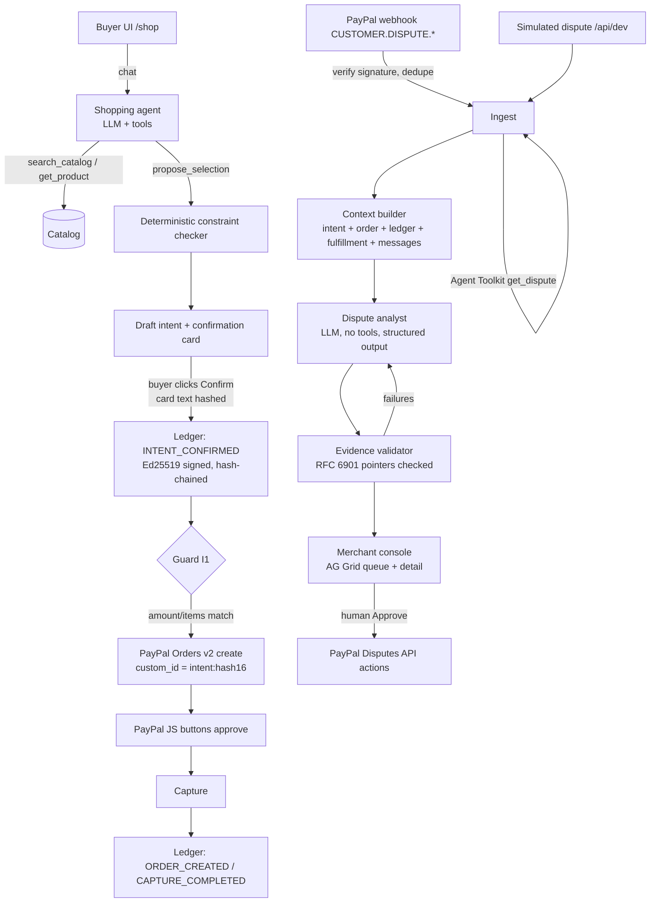

# Architecture

## Modules

| Path | Responsibility |
|---|---|
| `src/lib/ledger/` | Canonical JSON, SHA-256 hash chain, Ed25519 signing (`node:crypto`), verification. `canonical.ts` is shared with the browser Verify. |
| `src/lib/catalog/constraints.ts` | Deterministic constraint checker (`constraints@1`): MET / UNMET / UNKNOWN, never guesses. |
| `src/lib/intents/` | Intent records (`intent-record/0.1`), confirmation card text, confirmation that re-derives and hashes the card text. |
| `src/lib/paypal/` | OAuth + REST client, Orders create/capture with guard I1, webhook verification, Agent Toolkit adapter. |
| `src/lib/ai/provider.ts` | The only provider-aware module: model selection by env, budget cap, 2-wide queue, 429 backoff, usage log. |
| `src/lib/ai/agent.ts` | Shopping agent turn: tools `search_catalog`, `get_product`, `propose_selection`, `check_order_status` (toolkit). |
| `src/lib/ai/validator.ts` | JSON Pointer resolution, value comparison, instruction-like text detection. |
| `src/lib/disputes/` | Ingest (webhook + simulated share one path), context builder, analyst pipeline with fallback, actions with stored previews. |
| `prompts/*.md` | Versioned prompts (`shop-agent@1`, `dispute-analyst@1`). |

## Invariants and where they are enforced

| | Invariant | Code | Test |
|---|---|---|---|
| I1 | No order without a signed confirmation; amount/currency/items must equal the confirmed selection | `assertOrderMatchesIntent`, `createOrderForIntent` | `tests/flow.test.ts` "invariant I1" |
| I2 | Ledger append-only; every read verifies the chain | SQLite trigger `ledger_no_update`; `verifyLedger()` on receipt, dispute context, health | `tests/ledger.test.ts` tamper tests |
| I3 | Analyst has no tools; sees only the assembled context; messages are delimited untrusted data | `runAnalyst` uses `generateStructured` (no tools); `analystPrompt` | `tests/flow.test.ts`, S4 scenario |
| I4 | Nothing is sent to PayPal without a human click; request stored before sending | `approveAction` requires `human_confirmed: true`, stores preview first | `tests/flow.test.ts` "I4" |
| I5 | Every AI output stores provider, model, prompt_version, input_sha256, created_at | `analyses` table; intent record `agent` block | `tests/ai-wiring.test.ts` |
| I6 | Secrets only from env, never sent to client | `src/lib/env.ts`; only `NEXT_PUBLIC_PAYPAL_CLIENT_ID` reaches the browser | code review |

## Ledger format

`hash = SHA-256(canonical_json({seq, type, intent_id, payload, prev_hash}))`, genesis `prev_hash` = 64 zeros. Canonical JSON = keys sorted recursively, no whitespace, `JSON.stringify` escaping, finite numbers only (matches RFC 8785 for the values we store). Signature = Ed25519 over the 32 hash bytes. Public key at `/.well-known/intent-receipt-key.json` (JWK + SPKI).

"Tamper-evident", not "tamper-proof": someone with database write access can change rows, but the change is detected by Verify (first bad `seq` reported) unless they also hold the signing key.

## Dispute analyst reliability design

1. Context is a single JSON object; prompts describe the exact output schema; temperature 0.1.
2. Output validated with zod; one retry on schema failure.
3. Every citation is a JSON Pointer; the validator resolves it and compares `quoted_value` (strings whitespace-normalized, numbers by value).
4. Any failure triggers one corrective re-run listing the failures; still-failing items are dropped from the UI and counted; more than one double failure marks "Needs human review".
5. If the live call fails (no key, budget, 429, timeout 60 s) the seeded scenarios fall back to a stored analysis with a **CACHED** badge and its origin; other disputes go to ERROR with Retry. Nothing stays in ANALYZING.

## AI eval

`npm run ai-eval` runs S1 to S4 five times against the configured runtime model and prints the table below.

**Status: not yet run.** No runtime AI key was available while building. Paste the table here after running it; do not edit the numbers.

| Scenario | Expected action | Expected action hit | Classification hit | Verified ratio (after validation) | Raw citation pass rate |
|---|---|---|---|---|---|
| (pending) | | | | | |

Targets from the brief: expected action in at least 80% of runs; 100% of shown evidence verified (guaranteed by construction); injection ignored 5/5 (S4 expected CONTEST).
